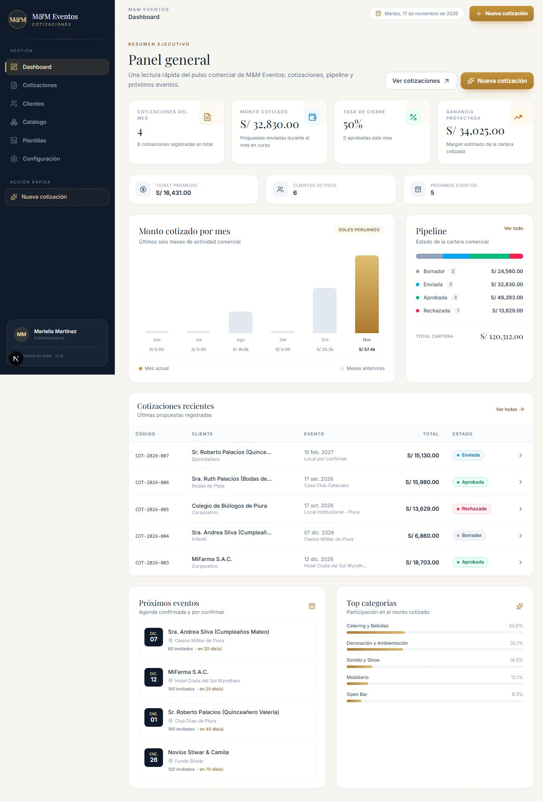
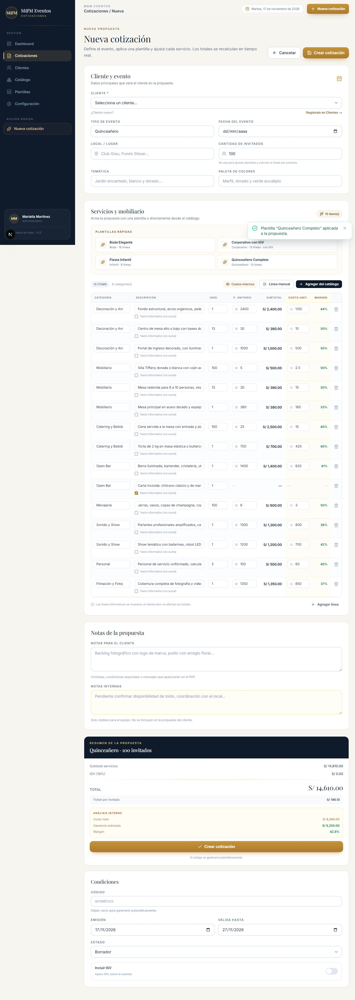
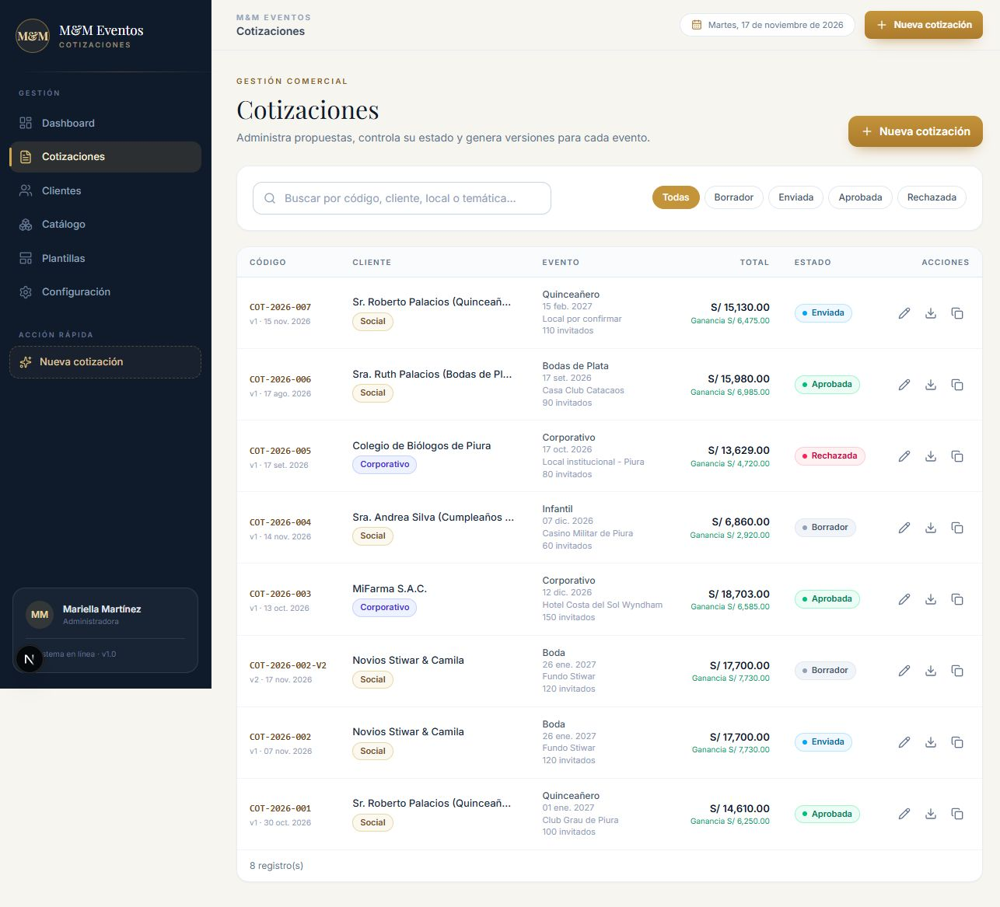
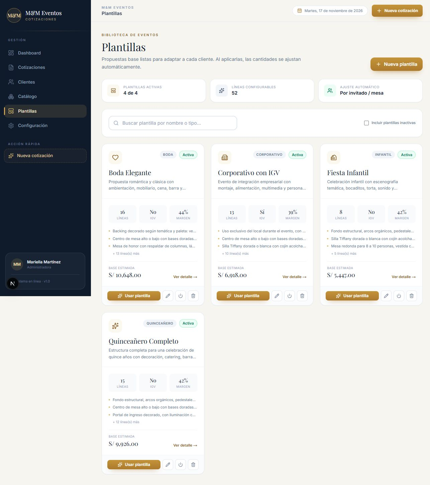

# M&M Eventos · Sistema de Cotizaciones

Sistema web interno para crear, versionar y dar seguimiento a las cotizaciones de eventos de **M&M Eventos**. Reemplaza el flujo de plantillas de Excel por un cotizador guiado con catálogo de servicios, plantillas por tipo de evento, control de estados, dashboard comercial y exportación profesional a PDF y Excel.

> Proyecto desarrollado a partir del documento de diseño, el prototipo HTML y el catálogo real de la empresa. No importa las cotizaciones históricas: incluye catálogo, plantillas y datos demo para operar desde el primer arranque.

---

## Capturas

| Dashboard | Cotizador |
| --- | --- |
|  |  |

| Cotizaciones | Plantillas |
| --- | --- |
|  |  |

---

## Funcionalidades

### Dashboard comercial
- KPIs del mes: cotizaciones, monto cotizado, tasa de cierre, ganancia proyectada, ticket promedio y clientes activos.
- Pipeline por estado (`Borrador`, `Enviada`, `Aprobada`, `Rechazada`) con cantidades y montos.
- Serie mensual de los últimos seis meses.
- Próximos eventos y participación por categoría.
- Accesos directos a cotizaciones recientes.

### Cotizaciones
- Creación guiada con cliente, datos del evento, invitados, temática, paleta y condiciones.
- Aplicación de plantillas con ajuste automático por invitados, mesas o mozos.
- Ítems desde catálogo o líneas manuales.
- Subítems informativos que aparecen en la propuesta pero no suman.
- Cálculo en tiempo real de subtotal, IGV, total, ticket por invitado, costo interno, ganancia y margen.
- Estados con cambio rápido y filtros por texto, estado, cliente y fechas.
- Versionado: duplicar una cotización genera una nueva versión con su código correlativo.
- Código automático `COT-AAAA-NNN` y `COT-AAAA-NNN-Vn`.
- Exportación a PDF para el cliente y a Excel en dos variantes: cliente e interno con costos.

### Clientes
- Directorio social y corporativo con búsqueda y filtros.
- Datos de contacto, documento, dirección y notas internas.
- Desactivación lógica sin perder el historial.
- Alta rápida desde el cotizador.

### Catálogo maestro
- 11 categorías y 69 servicios/mobiliario con precios de venta y costos internos.
- Reglas de cantidad: manual, por invitado, por mesa y por mozo.
- Stock referencial, unidades de medida y márgenes calculados.
- Gestión de categorías e ítems, activación/desactivación y visibilidad de costos.

### Plantillas de evento
- Cuatro plantillas base: Boda Elegante, Corporativo con IGV, Fiesta Infantil y Quinceañero Completo.
- Vista previa con líneas, base estimada y margen.
- Aplicación con cantidad de invitados indicada.
- Editor con líneas de catálogo y líneas manuales.

### Configuración
- Datos legales y comerciales de la empresa para las propuestas.
- Logo, RUC, dirección, teléfono, correo, web y términos y condiciones.
- Porcentaje de IGV configurable (18 % por defecto).

---

## Stack

| Capa | Tecnología |
| --- | --- |
| Frontend | Next.js 16.4.6 (App Router), React 19.3, TypeScript, Tailwind CSS 4.3, lucide-react |
| Backend | Java 21, Spring Boot 3.5.16, Spring Web, Spring Data JPA, Bean Validation, Actuator |
| Base de datos | PostgreSQL 16, Flyway |
| Exportaciones | OpenPDF 1.3.43 (PDF), Apache POI 5.3.0 (Excel) |
| Infraestructura | Docker / Docker Compose, Maven Wrapper |

Diseño visual: identidad dorado/slate, tipografías Playfair Display e Inter, componentes propios y diseño responsive.

---

## Estructura

```text
desarrollo/
├── backend/                 API REST Spring Boot
│   ├── src/main/java/pe/mmeventos/cotizaciones/
│   │   ├── catalogo/        Categorías e ítems
│   │   ├── cliente/         Clientes
│   │   ├── cotizacion/      Cotizaciones, totales y versionado
│   │   ├── dashboard/       KPIs y series
│   │   ├── empresa/         Configuración de la empresa
│   │   ├── export/          PDF y Excel
│   │   ├── plantilla/       Plantillas de evento
│   │   └── seed/            Catálogo y datos demo
│   ├── src/main/resources/db/migration/
│   └── Dockerfile
├── frontend/                Next.js App Router
│   ├── src/app/             Rutas y páginas
│   ├── src/components/      Shell, formularios y UI
│   ├── src/lib/             API, tipos, formato y constantes
│   └── Dockerfile
├── docs/img/                Capturas para documentación
├── scripts/                 INIT, stop y reset
├── docker-compose.yml       PostgreSQL + perfiles full
├── .env.example
├── INIT.md
└── README.md
```

---

## Inicio rápido

### Requisitos

- Docker Desktop
- Java 21 o superior (`JAVA_HOME` configurado)
- Node.js 22 o superior
- Git

### Windows (PowerShell)

```powershell
cd desarrollo
.\scripts\init.ps1
```

El script crea `.env` si no existe, levanta PostgreSQL en Docker, instala dependencias del frontend y arranca API y web en segundo plano.

- Frontend: <http://localhost:3000>
- API: <http://localhost:8081/api>
- Health: <http://localhost:8081/actuator/health>

Detener los procesos locales:

```powershell
.\scripts\stop.ps1
```

### Linux / macOS / Git Bash

```bash
cd desarrollo
chmod +x scripts/*.sh
./scripts/init.sh dev
```

Detener:

```bash
./scripts/stop.sh
```

### Solo base de datos

```powershell
.\scripts\init.ps1 -Mode db
```

### Todo en Docker

Construye y levanta PostgreSQL, backend y frontend:

```powershell
.\scripts\init.ps1 -Mode docker
# o
docker compose --profile full up -d --build
```

Detener el stack completo:

```powershell
docker compose --profile full down
```

> El perfil `full` evita que `docker compose up -d` levante contenedores de aplicación cuando se trabaja en modo local. Sin perfil, solo arranca PostgreSQL.

---

## Puertos y URLs

| Servicio | Host | Contenedor |
| --- | --- | --- |
| Frontend | <http://localhost:3000> | 3000 |
| API REST | <http://localhost:8081/api> | 8081 |
| Actuator health | <http://localhost:8081/actuator/health> | 8081 |
| PostgreSQL | `localhost:5433` | 5432 |

El puerto **5433** evita conflictos con otras instalaciones locales de PostgreSQL en 5432.

---

## Variables de entorno

Copia `.env.example` a `.env` y ajusta lo necesario:

| Variable | Default | Descripción |
| --- | --- | --- |
| `POSTGRES_DB` | `mm_eventos` | Nombre de la base de datos |
| `POSTGRES_USER` | `mm_eventos` | Usuario de PostgreSQL |
| `POSTGRES_PASSWORD` | `mm_eventos_dev` | Contraseña de desarrollo |
| `POSTGRES_PORT` | `5433` | Puerto de PostgreSQL en el host |
| `BACKEND_PORT` | `8081` | Puerto del backend en el host |
| `FRONTEND_PORT` | `3000` | Puerto del frontend en el host |
| `SEED_ENABLED` | `true` | Carga catálogo y datos demo si la base está vacía |
| `CORS_ALLOWED_ORIGINS` | `http://localhost:3000,http://127.0.0.1:3000` | Orígenes permitidos |
| `NEXT_PUBLIC_API_URL` | `http://localhost:8081/api` | URL de la API usada por el navegador |

`NEXT_PUBLIC_API_URL` se incrusta en el build del frontend. Si cambias el puerto del backend en Docker, reconstruye la imagen del frontend con el nuevo valor.

---

## Scripts

| Script | Función |
| --- | --- |
| `scripts/init.ps1` / `init.sh` | Inicialización completa en modo `dev`, `db` o `docker` |
| `scripts/stop.ps1` / `stop.sh` | Detiene backend y frontend locales iniciados por INIT |
| `scripts/reset-db.ps1` / `reset-db.sh` | Elimina el volumen de PostgreSQL y lo recrea |
| `init.ps1 -Reset` / `init.sh dev --reset` | Reinicia la base durante la inicialización |

Los logs de los procesos locales se guardan en `.run/`.

---

## Datos semilla

Al arrancar con una base vacía, el backend carga:

| Dato | Cantidad |
| --- | --- |
| Categorías de servicio | 11 |
| Ítems de catálogo | 69 |
| Plantillas de evento | 4 |
| Clientes demo | 6 |
| Cotizaciones demo | 8 |

Las cotizaciones demo cubren los cuatro estados y fechas variadas para que el dashboard, el pipeline y los reportes tengan información desde el primer inicio. El catálogo se basa en los datos reales del Excel de la empresa.

Si la base ya contiene datos, el seeder no duplica registros. Para recargar todo desde cero usa `reset-db`.

---

## Reglas de negocio

- **IGV**: 18 % configurable, se aplica solo si la cotización marca `incluyeIgv` y únicamente sobre líneas no informativas.
- **Subítems informativos**: se muestran en la propuesta y el PDF, pero no afectan subtotal, IGV, costo ni ganancia.
- **Cantidades de plantilla**: se ajustan según la regla del ítem:
  - `NINGUNA`: cantidad base fija.
  - `POR_INVITADO`: cantidad = invitados × base.
  - `POR_MESA`: cantidad = mesas × base (10 invitados por mesa).
  - `POR_MOZO`: cantidad = mozos × base (1 mozo por cada 25 invitados).
- **Costos internos**: nunca se incluyen en el PDF del cliente ni en el Excel de cliente; solo en el Excel interno y en la vista de análisis.
- **Estados**: `BORRADOR → ENVIADA → APROBADA / RECHAZADA`. El cambio es libre entre estados para permitir correcciones.
- **Versionado**: duplicar crea una cotización nueva enlazada a la original, con código `-V2`, `-V3`, etc. La versión original no se modifica.
- **Eliminación**: clientes, ítems, categorías y plantillas se desactivan lógicamente. Las cotizaciones en borrador pueden eliminarse.

---

## API REST

Base: `http://localhost:8081/api`

| Método | Ruta | Descripción |
| --- | --- | --- |
| GET | `/dashboard` | KPIs, pipeline, serie mensual y próximos eventos |
| GET | `/cotizaciones` | Listado paginado con filtros |
| GET | `/cotizaciones/{id}` | Detalle con totales |
| POST | `/cotizaciones` | Crear cotización |
| PUT | `/cotizaciones/{id}` | Actualizar cotización |
| PATCH | `/cotizaciones/{id}/estado` | Cambiar estado |
| POST | `/cotizaciones/{id}/duplicar` | Crear nueva versión |
| DELETE | `/cotizaciones/{id}` | Eliminar borrador |
| GET | `/cotizaciones/{id}/pdf` | Descargar PDF |
| GET | `/cotizaciones/{id}/excel?tipo=cliente\|interno` | Descargar Excel |
| GET/POST | `/clientes` | Listar y crear clientes |
| GET | `/clientes/opciones` | Clientes activos para selects |
| GET/PUT/DELETE | `/clientes/{id}` | Detalle, edición y desactivación |
| GET/POST | `/categorias` | Listar y crear categorías |
| PUT/DELETE | `/categorias/{id}` | Editar y desactivar categoría |
| GET/POST | `/catalogo` | Listar y crear ítems |
| GET/PUT/DELETE | `/catalogo/{id}` | Detalle, edición y desactivación |
| GET/POST | `/plantillas` | Listar y crear plantillas |
| GET/PUT/DELETE | `/plantillas/{id}` | Detalle, edición y eliminación |
| GET | `/plantillas/{id}/aplicar?invitados=N` | Aplicar plantilla ajustada |
| GET/PUT | `/empresa` | Consultar y guardar configuración |

Las respuestas de validación usan `400 Bad Request` con `message` y `fields`. Los recursos inexistentes devuelven `404`.

---

## Comandos de desarrollo

### Backend

```powershell
$env:JAVA_HOME="C:\Program Files\Java\jdk-21"   # ajusta tu ruta
cd backend
.\mvnw.cmd -DskipTests spring-boot:run
.\mvnw.cmd -DskipTests compile
.\mvnw.cmd test
```

### Frontend

```bash
cd frontend
npm install
npm run dev
npm run build
npm start
npm run lint
```

### Base de datos

```bash
docker compose up -d postgres
docker compose logs -f postgres
docker exec -it mm-eventos-db psql -U mm_eventos -d mm_eventos
```

---

## Verificación rápida

```powershell
Invoke-RestMethod http://localhost:8081/actuator/health
Invoke-RestMethod http://localhost:8081/api/dashboard
Invoke-RestMethod http://localhost:8081/api/cotizaciones?size=100
Invoke-RestMethod http://localhost:8081/api/catalogo
Invoke-RestMethod http://localhost:8081/api/plantillas
```

Flujo funcional validado:

1. Crear cliente.
2. Aplicar plantilla con invitados.
3. Guardar cotización y revisar totales.
4. Cambiar estado.
5. Duplicar como nueva versión.
6. Descargar PDF y ambos Excel.

---

## Alcance y siguientes pasos

El sistema está pensado como aplicación interna de una sola sede y no incluye autenticación ni roles todavía. Antes de exponerlo a internet se recomienda:

- Autenticación y roles (administrador, vendedor, solo lectura).
- Auditoría de cambios y historial de estados.
- Envío de propuestas por correo o enlace público.
- Adjuntar imágenes del evento y logo desde archivo (hoy el logo se configura por URL).
- Numeración por serie y año fiscal configurable.
- Respaldos automáticos de PostgreSQL.

---

## Documentación

- [INIT.md](INIT.md): instalación desde cero, verificación, reinicio y solución de problemas.
- [diseño de sistema.docx](../diseño%20de%20sistema.docx): documento funcional de referencia.
- [Prototipo HTML](../m_m_eventos_sistema_de_cotizaciones.html): referencia visual original.
